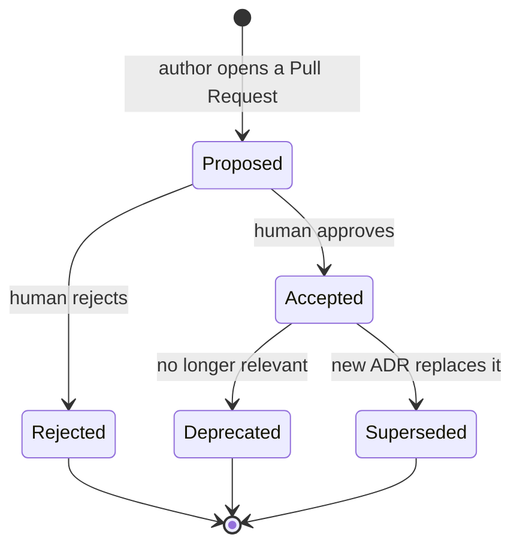

# Architecture Decision Records

An **Architecture Decision Record (ADR)** captures one significant decision about Blueprint Drafter,
its context, the alternatives considered and its consequences. ADRs are the memory of *why* the system
is shaped the way it is. The architecture that applies them is in [docs/architecture/](../architecture/).

## Index

| ADR | Title | Status | Date |
| --- | --- | --- | --- |
| [ADR-0001](ADR-0001-local-first-typescript-core-with-thin-adapters.md) | Build a local-first, deterministic TypeScript core library with thin adapters | Accepted | 2026-10-13 |
| [ADR-0002](ADR-0002-reuse-elk-layered-and-a-sequence-engine.md) | Reuse ELK Layered (elkjs) for graph layout and a dedicated sequence engine | Accepted | 2026-10-13 |
| [ADR-0003](ADR-0003-one-canonical-line-format-as-operation-language.md) | Use one line-based canonical text format that is also the operation language | Accepted | 2026-10-13 |
| [ADR-0004](ADR-0004-cli-first-then-mcp-skill-and-ci.md) | Expose the core through a CLI first, then a thin MCP server, an Agent Skill and a CI check | Accepted | 2026-10-13 |
| [ADR-0005](ADR-0005-apache-2-0-and-dependency-licence-policy.md) | License the project under Apache-2.0 and admit runtime dependencies by licence policy | Accepted | 2026-10-13 |
| [ADR-0006](ADR-0006-name-binary-extension-and-header.md) | Name the CLI binary, the diagram file extension and the format header keyword | Proposed | 2026-10-13 |
| [ADR-0007](ADR-0007-one-npm-package-compiled-esm-node-22.md) | Distribute one npm package with one binary, compiled to ESM for Node.js 22 or later | Proposed | 2026-10-13 |

Keep this index updated in the same Pull Request that adds or changes an ADR.

## When an ADR is required

Write an ADR when a decision is **significant and expensive to reverse**, in particular:

- Choosing or replacing a language, framework, layout engine or major library.
- Defining or changing a public contract: the core API, the text format, the operation language, the
  CLI commands and exit codes, the MCP tools or the diagnostic codes.
- Creating, moving or removing a trust boundary (for example what the MCP server may read or write).
- Adding a runtime dependency outside the licence policy of ADR-0005, a hosted service or a vendor.
- Changing how the package is distributed or released.
- Deliberately deviating from an existing ADR.

Decisions that are local, cheap to reverse and covered by existing conventions do not need an ADR.

## Naming

```text
docs/decisions/ADR-NNNN-kebab-case-title.md
```

`NNNN` is zero-padded and never reused. The title is short and names the decision.

## Format

Each ADR has the sections Status, Context, Decision, Alternatives, Consequences, Security
considerations and Operational considerations.

## Lifecycle



| Status | Meaning | Who sets it |
| --- | --- | --- |
| `Proposed` | Written and under discussion. Planning must not depend on it. | Author (Architect agent or human) |
| `Accepted` | In force. All work must comply. | A human (the repository owner) |
| `Rejected` | Considered and not adopted. Kept for the record. | A human |
| `Deprecated` | No longer relevant; not replaced. | A human |
| `Superseded by ADR-NNNN` | Replaced by a newer ADR. | A human, in the Pull Request that accepts the new ADR |

Rules:

- Agents write `Proposed` ADRs; only a human decision changes an ADR's status. An agent may record an
  acceptance only by citing the human's written approval (link in the ADR's status section).
- After acceptance, the Context, Decision and Alternatives sections are immutable. Typos may be fixed;
  meaning may not change. To change a decision, write a new ADR that supersedes the old one and change
  only the old ADR's status line.
