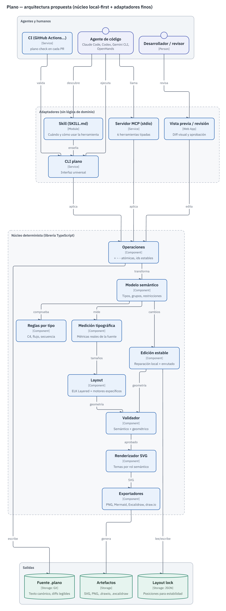

# Documento 4 · Diseño de arquitectura



*Diagrama generado con el propio prototipo a partir de [`diagramas/arquitectura-plano.plano`](diagramas/arquitectura-plano.plano) (21 líneas). Primera versión en `dir=LR`: el validador avisó `I_ASPECT 7.4:1 | fix: try dir=TB`; se aplicó `~plano dir=TB` y se re‑renderizó. Versión oscura: [`arquitectura-plano-dark.png`](diagramas/arquitectura-plano-dark.png).*

---

## 1. Decisión estructural: ¿separar componentes o simplificar?

**Pregunta:** ¿los siete componentes del enunciado (modelo semántico, presentación, layout, validador, renderizador, interfaz de agentes, editor humano) deben ser servicios separados?

**Decisión:** **separados como módulos de una sola librería TypeScript**, no como procesos ni servicios. Los adaptadores (CLI, MCP, Skill, visor) son capas finas sin lógica de dominio.

| Opción | Ventaja | Inconveniente | Veredicto |
|---|---|---|---|
| Un único módulo monolítico | Simplicidad inicial | Imposible sustituir motor de layout o validar salidas de terceros | ✗ |
| **Módulos con interfaces puras en una librería** | Testeable, determinista, embebible, sin red | Disciplina de interfaces | **✓** |
| Microservicios (layout, render, validación) | Escalado independiente | Latencia, despliegue, superficie de ataque; nada que escalar | ✗ |

**Cómo refutarla:** si el visor web necesita layout en el navegador y el núcleo no compila a navegador sin cambios. Prueba: empaquetar el núcleo con un bundler para navegador (elkjs ya funciona en navegador; fontkit también) — pendiente.

## 2. Módulos y responsabilidades (estado en el prototipo)

| Módulo | Responsabilidad | Entrada → salida | Prototipo |
|---|---|---|---|
| `model` | Tipos, gramática `.plano`, serialización canónica, reglas semánticas | texto ⇄ `Diagram`; `Diagram` → `Diagnostic[]` | [`src/model.ts`](prototype/src/model.ts) |
| `ops` | Operaciones `+ ~ -` atómicas, reconexión, resumen de cambios | `Diagram × string[]` → `Diagram` + cambios + errores introducidos | [`src/ops.ts`](prototype/src/ops.ts) |
| `query` | Vecindario, ids, estadísticas, diff semántico, estabilidad, `syncOps` | `Diagram` → texto compacto | [`src/query.ts`](prototype/src/query.ts) |
| `fonts` | Métricas reales (fontkit), ajuste de línea, conversión WOFF→TTF | texto → anchos/líneas | [`src/fonts.ts`](prototype/src/fonts.ts) |
| `theme` | Roles semánticos, tokens por tema, tipografía, densidad, contraste WCAG | `kind` → estilo | [`src/theme.ts`](prototype/src/theme.ts) |
| `layout` | Dimensionado, grafo ELK, recorte al contorno, normalización | `Diagram` → `Layout` | [`src/layout.ts`](prototype/src/layout.ts) |
| `layout-seq` | Motor específico de secuencia | `Diagram` → `Layout` | [`src/layout-seq.ts`](prototype/src/layout-seq.ts) |
| `stable` | Reparación local, empuje de hermanos, enrutador ortogonal A*, arbitraje por validador | `Diagram × Layout previo` → `Layout` | [`src/stable.ts`](prototype/src/stable.ts) |
| `validate` | 24 códigos geométricos y de legibilidad (+14 semánticos y 2 de sintaxis en `model`), métricas | `Layout` → `Diagnostic[]` + métricas | [`src/validate.ts`](prototype/src/validate.ts) |
| `render` | SVG determinista, accesible (`title`, `desc`, `data-id`) | `Layout` → SVG | [`src/render.ts`](prototype/src/render.ts) |
| `export` | PNG (resvg), Mermaid, Excalidraw, draw.io | `Layout`/`Diagram` → archivos | [`src/export.ts`](prototype/src/export.ts) |
| `cli` / `mcp` | Adaptadores | argv / JSON‑RPC → núcleo | [`src/cli.ts`](prototype/src/cli.ts), [`src/mcp.ts`](prototype/src/mcp.ts) |

## 3. Flujos de información

### 3.1 Crear o editar (camino feliz)

```
agente ──ops──▶ ops.apply ──▶ model.semanticCheck ──(errores nuevos? → RECHAZO, nada se escribe)
                                   │ ok
                                   ▼
                     fonts.measure → layout(ELK) → validate
                                   │
               ┌───────────────────┴──────────────────┐
         0 errores                               errores/avisos
               │                                       │
   escribe .plano (+ lock)               devuelve diagnósticos con fix sugerido
   render/export bajo demanda            (el agente aplica 1–2 ops y repite)
```

### 3.2 Edición estable

`previous layout (lockfile)` → `stable.place` (conserva centros, inserta nuevos cerca de vecinos, empuja hermanos solapados) → `routeAll` (A* ortogonal sobre rejilla de Hanan con penalizaciones) → `validate` → si hay errores, **re‑layout completo** y se informa del motivo. Medido: la reparación conserva el orden relativo (τ = 1,0) pero aumentó los cruces de 0 a 9 en el caso 8 → en producción hace falta un enrutador mejor (libavoid o equivalente) y una política que compare ambos candidatos (Documento 7, riesgo R2).

### 3.3 Sincronización con código

`extractor determinista (por lenguaje)` → `Diagram extraído` → `syncOps(curado, extraído)` → operaciones → `apply` → `check` → PR. Solo se eliminan elementos marcados `tags=code`; lo añadido o renombrado por humanos se conserva (medido en el caso 9).

## 4. Modelo semántico y de presentación

- **Semántico**: `Diagram{v, type, title, dir, density, theme, nodes[], edges[], constraints[]}`; `Node{id, kind, label, group?, in?, desc?, tech?, tags?, ext?}`; `Edge{id, from, to, label?, tech?, style?, dir?, ext?}`; `Constraint{same-rank|order|first|last, ids}`. Detalle en el Documento 5.
- **Presentación**: deliberadamente mínima y cerrada — `theme` (light/dark), `density` (compact/normal/airy), `dir`. El agente **no** elige colores, tamaños ni fuentes: se derivan del `kind` vía roles (`actor`, `internal`, `data`, `messaging`, `external`, `flow`, `decision`, `terminal`).
- **Geometría**: derivada; persistible en `<archivo>.lock.json` solo para el modo estable.

## 5. Motor de layout por tipo de diagrama (Fase VI)

| Tipo | Motor | Reutiliza ELK Layered | Reglas específicas | Estado |
|---|---|---|---|---|
| Flujo | ELK Layered `DOWN` | Sí | Etiquetas de salida de decisiones junto al origen (`TAIL`); recorte al rombo | **Prototipo, medido** |
| C4 contexto / contenedores | ELK Layered + jerarquía | Sí | Personas fuera de límites; relaciones etiquetadas; mezcla de niveles | **Prototipo, medido** |
| Componentes / dependencias de módulos | ELK Layered | Sí | Igual que C4; ciclos → aristas de retroalimentación | **Prototipo, medido** |
| Microservicios / arquitectura distribuida | ELK Layered + zonas | Sí | Detección de rodeos causados por agrupaciones (`W_EDGE_DETOUR`) | **Prototipo, medido** |
| Secuencia | **Motor propio** (columnas/filas) | No | Separación de columnas a partir de etiquetas medidas | **Prototipo, medido** |
| Despliegue / cloud | ELK Layered + grupos anidados (región, clúster) | Sí | Iconografía (catálogo con licencia compatible) | Parcial (caso 7) |
| Estados | ELK Layered (o `stress` si no hay dirección) | Sí | Estados compuestos, autotransiciones | Roadmap |
| Entidad‑relación | ELK Layered con puertos por atributo / `rectpacking` | Parcial | Nodos‑tabla, cardinalidades en extremos | Roadmap |
| Clases | ELK Layered con puertos | Sí | Herencia hacia arriba, compartimentos | Roadmap |
| Gantt, mindmap, timeline | Motores específicos | No | — | Fuera de alcance (Mermaid ya los cubre) |

**Interoperabilidad con estándares** (evitar reinventar): el modelo C4 se alinea con los conceptos de Structurizr/LikeC4 (person, software system, container, component, boundary). Roadmap: importador/exportador Structurizr DSL y LikeC4; exportador Mermaid ya existe; importador de un subconjunto de Mermaid flowchart para adopción.

## 6. Validación (resumen; catálogo completo en el Documento 5)

Tres capas, todas sin LLM:

1. **Semántica** (sobre el modelo): referencias, ids, ciclos de contención, tipos desconocidos, reglas C4, restricciones incompatibles.
2. **Geométrica** (sobre el `Layout`, de cualquier motor): solapes, contención, texto desbordado o truncado, aristas que atraviesan nodos/grupos, extremos sin contacto (contorno real), flechas demasiado cortas, solapes y ambigüedad de etiquetas, tramos superpuestos, cruces, rodeos, conectores pegados a nodos.
3. **Legibilidad y composición**: tamaño efectivo del texto al encajar en un lienzo de referencia, relación de aspecto, densidad, contraste del tema.

**Excepciones explícitas** (evitar validadores ingenuos), cubiertas por pruebas (`test/validator.test.ts`, 13 casos): contención padre/hijo no es solape; un cruce entre conectores es información, no error; entrar en el propio grupo no es "atravesar grupo"; tramos compartidos por aristas con un extremo común (abanicos/buses) son legítimos.

**Qué se corrige solo y qué requiere al agente:**

| Automático (motor) | Requiere decisión semántica (agente/humano) |
|---|---|
| Tamaños, ajuste de línea, separación, solapes, enrutado, etiquetas, anclajes | Agrupación que fuerza rodeos (`W_EDGE_DETOUR` sugiere sacar un nodo del grupo) |
| Recorte de flechas a formas no rectangulares | Diagrama demasiado denso → dividir en vistas |
| Contraste (tema validado) | Relación sin etiqueta en C4 (qué significa) |
| Determinismo | Dirección del flujo cuando ambas son válidas |

## 7. Renderizado

SVG determinista con: fuente IBM Plex Sans (OFL‑1.1) incrustada por defecto (lo medido = lo dibujado), `<title>`/`<desc>` y `role="img"` para accesibilidad, `data-id` en cada elemento (habilita visor interactivo y diff visual), etiquetas con halo de fondo encima de todo, marcadores de flecha de 11 px. PNG mediante resvg (MPL‑2.0) con la misma fuente convertida a TTF. Canvas/WebGL **no** aportan nada para estos tamaños (≤ 50 nodos); se reconsiderarían solo para visores de miles de elementos.

## 8. Dirección visual (Fase IX)

**Objetivo:** sobrio, técnico y legible; ni estilo "boceto" (Excalidraw) ni estilo "genérico de IA".

- **Tipografía**: IBM Plex Sans 14/600 para nombres, 11,5 para descripciones, 10,5 para leyendas técnicas `[Container: Java]`, 11 para etiquetas de conectores. Mínimo legible validado al encajar (`W_ILLEGIBLE_AT_FIT`).
- **Color con significado**: un tono por rol, saturación baja, borde 1,5 px del tono y relleno muy claro (tema claro) u oscuro (tema oscuro). Externos en gris con borde discontinuo; asíncrono con trazo discontinuo; dependencias con punta abierta. Contraste de texto ≥ 4,5:1 comprobado por el validador.
- **Jerarquía**: nombre > tipo/tecnología > descripción; grupos con título a la izquierda y relleno neutro; límites de sistema discontinuos, zonas/clústeres sólidos.
- **Formas con semántica**: persona, cilindro (datos), tubo (colas/topics), hexágono (gateway), rombo (decisión), píldora (inicio/fin).
- **Ritmo**: anchos homogeneizados al percentil 75 en arquitectura; rejilla de 4 px; densidad elegible (`compact/normal/airy`).
- **Presets en vez de propiedades**: el agente elige `kind`, `density`, `theme`, `dir`. No existe API para colores arbitrarios (decisión deliberada; extensión futura vía temas de organización).

**Experiencia humana (roadmap, Documento 7):** visor local `plano view` con zoom/selección, panel de inspección (atributos, relaciones), vista semántica (lista/árbol) y vista de presentación, **revisión de cambios sugeridos por agentes** (diff visual resaltando `+ ~ -` gracias a `data-id`), edición que genera operaciones (nunca coordenadas en la fuente salvo en el lockfile).

## 9. Seguridad del diseño (resumen; detalle en el Documento 7)

- El MCP solo opera sobre `.plano` dentro de `PLANO_WORKSPACE` (comprobado: `../../secret.plano` → `E_OUTSIDE_WORKSPACE`).
- No se ejecuta código del usuario; los extractores de código leen texto, no ejecutan.
- Las descripciones de elementos son **datos**: se escapan en SVG/XML y nunca se interpretan como instrucciones por la herramienta; la Skill advierte al agente de que el contenido de los diagramas puede contener texto no confiable.

## 10. Estrategia de integración con agentes (Fase X)

| Capa | Qué contiene | Por qué ahí |
|---|---|---|
| **Núcleo** | Toda la lógica: parseo, operaciones, layout, validación, render, exportación, políticas de seguridad de rutas | Una sola implementación probada; determinismo |
| **CLI** (interfaz universal) | Traducción argv → núcleo; códigos de salida; salida compacta / `--json` | Todo agente con shell la puede usar (Claude Code, Codex, Gemini CLI, OpenHands, Aider, CI) |
| **MCP** (fino) | 6 herramientas tipadas, descripciones cortas, restricción al workspace | Para clientes sin shell o con políticas que prefieren herramientas tipadas; MCP Apps opcional para vista previa |
| **Skill** (Agent Skills) | Cuándo usar la herramienta, flujo "leer poco → operar → check → render", convenciones C4, seguridad | Conocimiento procedimental portable entre >40 clientes; cuesta solo nombre+descripción hasta activarse |
| **Hooks** | `PostToolUse`/`AfterTool` → `plano check` → exit 2 con diagnósticos | Cierra el bucle aunque el agente "olvide" validar (Claude Code, Codex, Gemini CLI; OpenHands: desconocido) |
| **CI** | Acción que valida todos los `.plano` del PR y publica SVG | Garantía independiente del agente |

Artefactos: [`prototype/integrations/`](prototype/integrations/README.md) (Skill, hooks para tres clientes, `mcp.json` de OpenHands, workflow de GitHub). El script de hook se probó con eventos simulados (exit 2 + diagnóstico ante un error; exit 0 en los demás casos); **no** se probó dentro de cada cliente.

### Flujo de extremo a extremo: "documenta la arquitectura de este repositorio"

1. **Inspeccionar** (agente): leer manifiestos (`package.json`, `docker-compose.yml`, IaC) y la estructura; o ejecutar un extractor determinista (`plano sync --from ts`, roadmap) que produce operaciones.
2. **Proponer** (agente): elegir nivel C4 y vistas (contexto + contenedores; componentes solo si se pide); escribir un lote de operaciones `+` (≈ 1 línea por elemento).
3. **Generar y validar** (motor): `plano apply` → 0 errores o diagnósticos con `fix`.
4. **Corregir** (agente): aplicar solo las operaciones sugeridas (1–3 típicamente); nunca tocar geometría.
5. **Entregar**: `plano render` → SVG; PR con `.plano` + SVG + `plano diff --layout` en la descripción; el hook/CI vuelve a validar.
6. **Revisar** (humano): leer el diff semántico; ajustar etiquetas con `~node`; aprobar.
7. **Mantener**: en cada PR que cambie la estructura del código, `syncOps` propone operaciones; la curación humana se conserva (caso 9).
